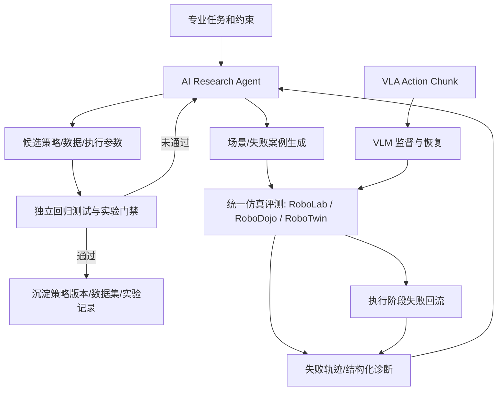

# NVIDIA GTC Berlin 2026：具身智能技术洞察与后续研发路线

> 更新：2026-10-27｜类别：行业技术洞察 / 研发路线｜状态：技术判断与实验计划（非已验证结果）

## 摘要

2026 年 10 月 21 日 NVIDIA GTC Berlin 的具身智能主线，不是单个 VLA 模型的排行榜提升，而是将**模型、数据、仿真、策略训练、评测、运行时和 Agent 编排**组织为闭环开发平台。对于已经具有 Isaac Lab、RoboLab/RoboDojo、RoboTwin、VLA、Cosmos 和本地 VLM 的研发体系，优先级应由“持续引入新模型”转向“可复现的自动研发与可靠性改进”。

**核心方向：Embodied Autoresearch——Agent 自动发现机器人失败、提出候选改进、执行受控实验、用独立测试集判断是否有效。**

## 1. GTC 2026 具身智能重要发布

| 发布 | 状态（截至 2026-10-27） | 技术意义 | 研发建议 |
| --- | --- | --- | --- |
| Isaac Lab 3.0 | 正式开源发布 v3.0.0 | 多物理/渲染后端、Kit-less、Warp 数据路径、Agent-ready | 独立兼容性分支，不直接替换现有基线 |
| Isaac OS | 官方宣布基于 Holoscan 的开源运行时；独立完整仓库及分发状态仍需逐项核实 | 感知、AI、控制与硬件连接 | 真实机器人部署时再重点评估 |
| SimReady Central | 2,000+ 仿真就绪资产 | 缩短场景搭建周期 | 评估药房/样本库资产复用，保留专业物理属性 |
| Human 1M | 公布三视角人体活动与 3D 手部信息；完整数据有合作伙伴访问限制 | 人类动作理解与机器人学习数据 | 先做数据适配性核验 |
| GR00T 1.7 / Cosmos 参考工作流 | 官方发布后训练、强化学习及合成数据示例 | 从训练基础模型转向技能微调和数据闭环 | 借鉴受控后训练流程 |
| Agile ONE SN | 参考人形机器人，预计 2027 年初提供 | 提供相对统一的训练—部署载体 | 中长期观察，不作为短期交付依赖 |
| Halos | 安全开发/验证体系 | 从任务成功率走向可靠性与安全证据链 | 引入异常检测、回归测试和风险门禁 |

**版本迁移提示：** Isaac Lab 3.0 与 2.x 在四元数约定（WXYZ → XYZW）、`ProxyArray` 数据访问等方面存在破坏性变更。迁移前应冻结原版本、任务、随机种子和策略 checkpoint，建立对照测试，尤其检查坐标变换、接触行为和观测张量。

## 2. Microduck：Agent 驱动机器人研发的示范

NVIDIA 2026-10-23 技术文章展示了：本地 Agent（Hermes / Nemotron）规划任务；Astra 等工具创建 3D 资产；FreeCAD、Blender、Isaac Sim、Newton 完成建模与物理仿真；Isaac Lab 在 **4,096 个并行环境**中训练感知运动策略；最后进行策略验证与实体展示。

它证明了部分研发环节可以通过 Agent 协同自动化，**不等于**已经实现任意 VLA 技能的无人干预训练，也不能直接外推为机器人通用智能或可靠 Sim-to-Real 迁移。

### 与既有 AI-native 路线的关系

| 路线 | 作用层级 | 推荐组合 |
| --- | --- | --- |
| Code-as-Policy / GPT-as-Policy | 在线任务分解、动作逻辑或代码策略 | 作为策略候选，不代替独立安全评测 |
| ASPIRE / 自动修复 | 生成策略修复候选与执行回归测试 | 接入失败案例库和冻结评测集 |
| Spotter / VLM 验证 VLA | 运行时观察、异常发现、纠偏 | 保持 VLA 动作层与 VLM 监督层解耦 |
| Test-time Scaling / TTT | 推理增加搜索，或测试时进行适配 | 作为独立实验分支，严格核算成本 |
| Microduck Agent 工作流 | 研发流程编排、场景构建、训练与验证 | 借鉴工具链编排和实验自动化 |

## 3. 现有基础及研究问题

已有研发资产：

- 仿真与评测：Isaac Lab、RoboLab、RoboDojo、RoboTwin 任务与场景；
- 策略：LingBot-VLA、π0.5 等 VLA，固定 Action Chunk 评测以及在线纠偏探索；
- 数据：门诊药房补药、样本操作、Cosmos 增强、专业仿真资产；
- Agent：GPT-as-Policy、ASPIRE、Spotter、Code-as-Policy 的复现和移植探索；
- 算力：本地 Qwen/多模态模型与现有 GPU 资源。

历史实验曾观察到 RoboTwin **Clean 约 77%、Random 约 47%**，存在约 30 个百分点的泛化差距；这些是特定模型与设置的历史结果，并非统一排行榜数据。药房抓取/条码翻转也曾获得高成功率，下一步应检验未见遮挡、贴边与姿态变化下的可靠性。

**主研究问题：能否在不从头训练更大基础模型的条件下，用 Agent + 仿真 + VLM 监督使策略更可靠，并通过冻结测试集证明收益？**

## 4. 推荐架构：双闭环 Embodied Autoresearch

- **研发闭环（离线）**：场景生成 → 执行 → 失败归因 → 候选修复/训练 → 冻结集独立验证；
- **执行闭环（在线）**：VLA 生成动作 → 部分执行/重新观测 → VLM 检查 → 中断/恢复。默认不修改模型权重；
- **两层隔离**：生成改进建议的 Agent 不得修改验收指标、冻结测试集或基线定义；
- **可信指标**：成功率、泛化差距、失败类型召回、执行时延、GPU 小时成本、安全中断、回归退化。

## 5. 两条近期算法主线

### A. Action Chunk 与 VLM 纠偏消融

| 实验 | 对照方案 | 核心验证 |
| --- | --- | --- |
| A0 | VLA 固定 50 步执行 | 冻结基线 |
| A1 | 固定短执行窗口并重新观测 | 高频闭环的泛化收益与延迟代价 |
| A2 | 根据风险/动作阶段调整实际执行窗口 | 性能与效率权衡 |
| A3 | VLM 关键节点判断、中断和恢复 | 语义级异常监控是否有效 |
| A4 | A2 + A3 | 监督与可变窗口是否互补 |
| A5 | A4 + 失败驱动的数据微调 | 是否改善新分布而非只拟合已知错误 |

记录相同任务、策略 checkpoint、相同场景集及执行预算；避免把更多推理时间误读为模型本身提升。可以暂以 Random 场景成功率改善 5 个百分点且 Clean 退化不超过 2 个百分点为工程探索目标，**该阈值并非已取得结果或统计显著性结论**。

### B. 失败驱动的专业任务数据

例如，药盒贴边抓取失败：

1. 用物理轨迹、碰撞日志和 VLM 共同定位失败阶段；
2. 将失败原因转为场景参数：贴边距离、偏航角、遮挡、材质、光照、抓取起始姿态；
3. 在 Isaac Lab 中执行受控变体，采集成功示范或恢复轨迹；
4. 仅在冻结训练/验证隔离条件下微调策略；
5. 在未见场景中量化收益，失败则回滚候选。

目标从“合成多少数据”改变为“单位数据带来多少泛化和可靠性改善”。

## 6. 八周实施计划（研究建议）

| 周期 | 工作 | 可交付结果 |
| --- | --- | --- |
| W1–W2 | 统一策略/任务接口，固定种子、任务版本、日志及指标 | 可复现 Benchmark 与失败案例库 |
| W3–W4 | 构建 Failure Analysis Agent，并人工审核诊断结果 | 自动归因报告、受控测试生成 |
| W5–W6 | VLM 纠偏、自适应 Chunk、恢复策略消融 | 成功率/时延/成本三维对照 |
| W7–W8 | 打通 Agent 发起实验、候选改进、独立评测门禁 | Embodied Autoresearch MVP + Demo + 技术报告 |

### 近期不优先投入

- 不因版本新而整体迁移 Isaac Lab 3.0，先隔离测试；
- 不以统一 Git 仓库替代统一任务/评测 API；
- 暂不把 Isaac OS/Holoscan 当作仿真性能优化手段，它们主要服务真实机器人运行时；
- 不从零预训练大 VLA 或世界模型，优先利用现有模型、数据和 GPU。

## 7. 面向医疗康养的长期差异化

NVIDIA 强在通用算力、Isaac、Cosmos 和模型工具。专业研发平台的潜在壁垒在于：业务任务定义、授权场景数据、带语义与接触属性的专业仿真资产、操作 SOP、异常恢复与安全评测。

门诊药房不仅验证“抓到药盒”，还应验证药品身份、条码方向、目标位置、业务交接以及异常中断。康养任务需进一步设置护理约束、对象状态与人机交互安全边界，并严格遵守授权、脱敏和人员监控要求。

**研发目标：从单点任务成功走向专业任务可复现、可解释、可持续改进。**

## 8. 证据与资料

- NVIDIA 官方发布，2026-10-21：[Isaac Platform for General-Purpose Robotics](https://nvidianews.nvidia.com/news/nvidia-advances-isaac-platform-for-general-purpose-robotics-with-new-reference-humanoid-frameworks-simulation-pipelines-and-data)
- NVIDIA 技术文章，2026-10-23：[Using AI Agents to Teach Robots Like Microduck to Walk in Simulation](https://developer.nvidia.com/blog/using-ai-agents-to-teach-robots-like-microduck-to-walk-in-simulation)
- Isaac Lab 正式版：[GitHub v3.0.0 Releases](https://github.com/isaac-sim/IsaacLab/releases)
- NVIDIA Holoscan SDK：[GitHub](https://github.com/nvidia-holoscan/holoscan-sdk)
- NVIDIA Isaac ROS：[GitHub organization](https://github.com/NVIDIA-ISAAC-ROS)

> 说明：文中“建议”“目标”“趋势判断”属于研究规划，不应作为已经完成的实验成果对外宣传。
